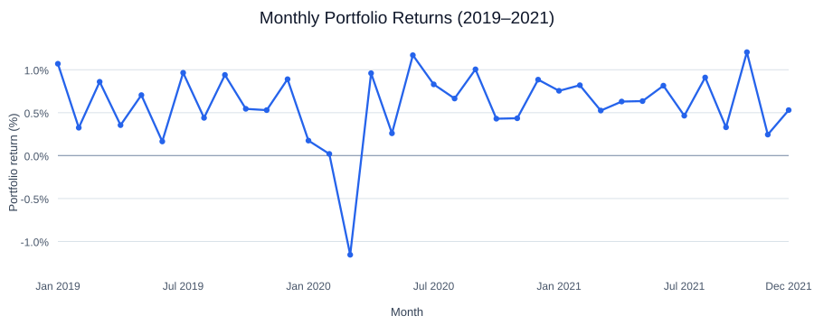

# Unit 9 Data Project: Portfolio Risk Analysis and Optimization

**Author:** Mei Qiong Xue  
**Period:** January 2019–December 2021  
**Tools:** Python, pandas, NumPy, Matplotlib, SciPy

## 1. Portfolio Return and Risk

### Monthly portfolio returns

**Table 1. Monthly portfolio returns, 2019–2021**

| Month | 2019 | 2020 | 2021 |
|---|---:|---:|---:|
| January | 1.070% | 0.175% | 0.755% |
| February | 0.325% | 0.020% | 0.820% |
| March | 0.860% | -1.155% | 0.525% |
| April | 0.355% | 0.960% | 0.630% |
| May | 0.705% | 0.260% | 0.635% |
| June | 0.165% | 1.170% | 0.815% |
| July | 0.965% | 0.830% | 0.465% |
| August | 0.440% | 0.665% | 0.910% |
| September | 0.940% | 1.005% | 0.330% |
| October | 0.545% | 0.430% | 1.205% |
| November | 0.530% | 0.435% | 0.245% |
| December | 0.890% | 0.885% | 0.530% |

**Figure 1. Monthly portfolio returns from 2019 to 2021**

Table 1 and Figure 1 present monthly returns calculated using the weighted returns of five assets. The portfolio generated positive returns in 35 of 36 months. The highest monthly return was 1.205% (October 2021), and the lowest was -1.155% (March 2020).

### Average return and volatility

**Table 2. Portfolio return and risk summary**

| Metric | Value |
|---|---:|
| Average monthly return | 0.59% |
| Monthly portfolio volatility | 0.43% |

The portfolio generated a positive average monthly return with relatively limited fluctuations. Volatility was measured using sample standard deviation.

### Covariance validation

**Table 3. Covariance matrix of five asset returns (monthly decimal-return units; rounded to six decimals)**

| Asset | Asset 1 | Asset 2 | Asset 3 | Asset 4 | Asset 5 |
|---|---:|---:|---:|---:|---:|
| Asset 1 | 0.000076 | 0.000004 | 0.000009 | 0.000031 | 0.000006 |
| Asset 2 | 0.000004 | 0.000065 | -0.000019 | 0.000024 | -0.000002 |
| Asset 3 | 0.000009 | -0.000019 | 0.000048 | -0.000013 | 0.000003 |
| Asset 4 | 0.000031 | 0.000024 | -0.000013 | 0.000069 | 0.000008 |
| Asset 5 | 0.000006 | -0.000002 | 0.000003 | 0.000008 | 0.000060 |

Most asset pairs exhibited positive covariance; some pairs, including Assets 2 and 3, exhibited negative covariance and potential diversification benefits. Portfolio volatility calculated from the covariance matrix and asset weights was **0.43%**, matching the direct standard-deviation calculation.

## 2. Sharpe Ratio

**Table 4. Portfolio Sharpe Ratio analysis**

| Metric | Value |
|---|---:|
| Average monthly portfolio return | 0.59% |
| Average monthly risk-free rate | 0.33% |
| Average monthly excess return | 0.26% |
| Monthly portfolio volatility | 0.43% |
| Monthly Sharpe Ratio | 0.62 |

The positive monthly Sharpe Ratio indicates excess return relative to the risk-free rate, adjusted for volatility. Benchmark comparison would be needed to judge relative performance.

## 3. Historical Value at Risk

**Table 5. Historical 95% VaR analysis**

| Metric | Value |
|---|---:|
| Confidence level | 95% |
| Fifth-percentile monthly return | +0.13% |
| Nonnegative monthly VaR loss estimate | 0.00% |
| Negative-return months | 1 of 36 |

The historical fifth-percentile return was positive, leading to a **0.00% nonnegative loss VaR** under the calculation used. This is not evidence that losses are impossible: the sample includes a loss month, and 36 observations provide limited information about rare downside events.

## 4. Stress Testing

**Table 6. Hypothetical stress test results**

| Metric | Original portfolio | Stressed portfolio |
|---|---:|---:|
| Average monthly return | +0.59% | -4.41% |
| Monthly volatility | 0.43% | 0.43% |
| Negative-return months | 1 | 36 |

A hypothetical **5-percentage-point reduction in each asset's monthly return** shifts all portfolio returns downward by five percentage points. The average becomes negative in all 36 months. Volatility remains unchanged because the same fixed amount is subtracted from every month; real crises may change volatility as well.

## 5. Risk Appetite Testing

The analysis compares independently selected conservative and aggressive allocations against the original weights.

**Table 7. Portfolio allocations and historical performance**

| Portfolio | Average monthly return | Monthly volatility |
|---|---:|---:|
| Original | 0.59% | 0.43% |
| Conservative | 0.57% | 0.39% |
| Aggressive | 0.64% | 0.52% |

| Asset | Original weight | Conservative weight | Aggressive weight |
|---|---:|---:|---:|
| Asset 1 | 20% | 10% | 30% |
| Asset 2 | 25% | 15% | 15% |
| Asset 3 | 15% | 30% | 10% |
| Asset 4 | 20% | 10% | 35% |
| Asset 5 | 20% | 35% | 10% |

The conservative allocation had the lowest historical volatility, while the aggressive allocation offered the highest average return with greater volatility. Individual asset volatility and covariance were considered when choosing alternative weights; historical results do not guarantee future outcomes.

## 6. Portfolio Optimization

A long-only portfolio was optimized using SciPy's SLSQP method to maximize the **historical monthly Sharpe Ratio**, with each asset weight constrained to 0–100% and total weights summing to 100%.

**Table 8. Optimized asset allocation**

| Asset | Original weight | Optimized weight |
|---|---:|---:|
| Asset 1 | 20.00% | 0.00% |
| Asset 2 | 25.00% | 6.00% |
| Asset 3 | 15.00% | 18.87% |
| Asset 4 | 20.00% | 43.45% |
| Asset 5 | 20.00% | 31.68% |
| **Total** | **100.00%** | **100.00%** |

**Table 9. Original vs. optimized historical performance**

| Metric | Original | Optimized |
|---|---:|---:|
| Average monthly return | 0.59% | 0.67% |
| Monthly volatility | 0.43% | 0.47% |
| Monthly Sharpe Ratio | 0.62 | 0.73 |

The optimized portfolio had higher historical average return and a higher Sharpe Ratio, despite slightly higher volatility. It allocated **75.13% to Assets 4 and 5**, creating concentration risk.

## Conclusion and Recommendation

Across 2019–2021, the original portfolio showed positive average monthly performance and a Sharpe Ratio of 0.62. The historical VaR estimate obscured the possibility of larger losses, which the hypothetical stress scenario illustrated. Alternative allocations showed a risk-return trade-off, and optimization improved the in-sample Sharpe Ratio to 0.73.

**Recommendation:** Treat the optimized allocation as a starting point, not an investment prescription. Consider position limits, additional stress scenarios, transaction costs, and out-of-sample validation before implementation. Results are based on historical course data and may not generalize to future markets.

*Data provenance: 36 monthly observations from a synthetic course dataset. The data are included in this repository as `data/portfolio_returns.csv`; the original Excel workbook and instructor notes are not redistributed.*
